# Loyalty Pocket

A mobile-first web app for in-store loyalty members: show the member code, surface the best offers, and check points in under 10 seconds, one-handed.

**Live site:** https://protogen303.vercel.app/ (best viewed on a phone; it is an installable PWA)

<p align="center">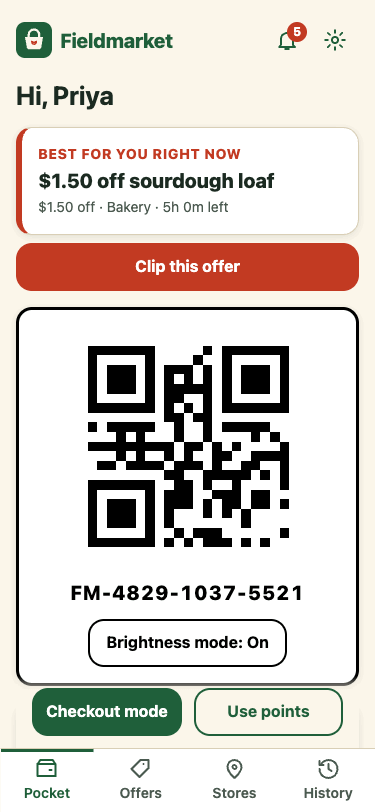</p>

> Fieldmarket is a **fictional brand** and every piece of data is invented, served by a mock API. No client or Slalom information is used.

## What it does

| Area | What you get |
|------|--------------|
| **Pocket** (home) | Scannable QR member code (cached, works offline), brightness mode, animated points balance, tier progress, and a **"best offer right now"** card with a one-tap clip |
| **Checkout mode** | Full-screen, always high-contrast code with your clipped offers listed. Keeps the screen awake while open |
| **Offers** | Search, section chips, "ending soon", and sort. Clip with a swipe **or** a button. Tap for details (products, stores, terms). Expiry countdowns, expired offers tucked away, clip changes queue offline and sync on reconnect |
| **Shopping list** | Add items from clipped offers or type your own. Items are sorted into the store's section order so you can walk the aisles |
| **Stores** | Nearest-store picker with hours, and a **floor-plan map** that lights up the sections where your clipped offers are (with a text list alongside for screen readers) |
| **History** | Earned vs. redeemed chart for six months, filters, transaction details, and a **redeem bottom sheet** with confetti |
| **Rewards** | Tier perks (Sprout, Harvest, Orchard) and a rewards catalog that explains why something is locked |
| **Inbox** | Expiring-offer and tier reminders, unread badge, optional device alerts |
| **Settings** | Preferred store, notifications, light/dark/system theme, install prompt, replay intro |

Also: first-run intro, dark mode, install prompt and app shortcuts, reduced-motion support, and loading / empty / error / offline states on every screen.

## Screens

<table>
  <tr>
    <td>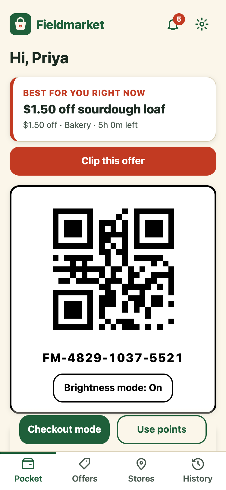</td>
    <td>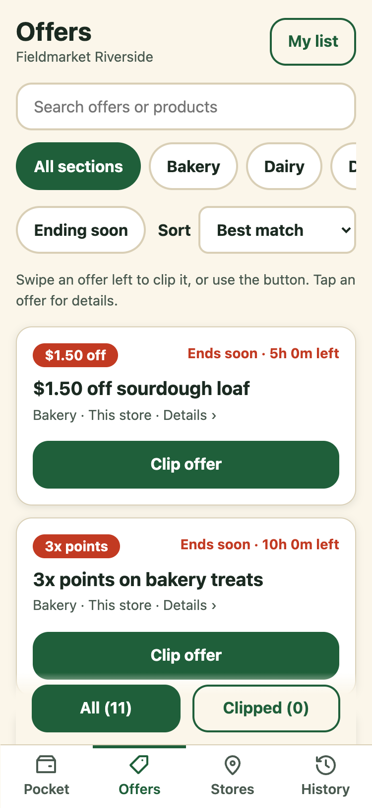</td>
    <td>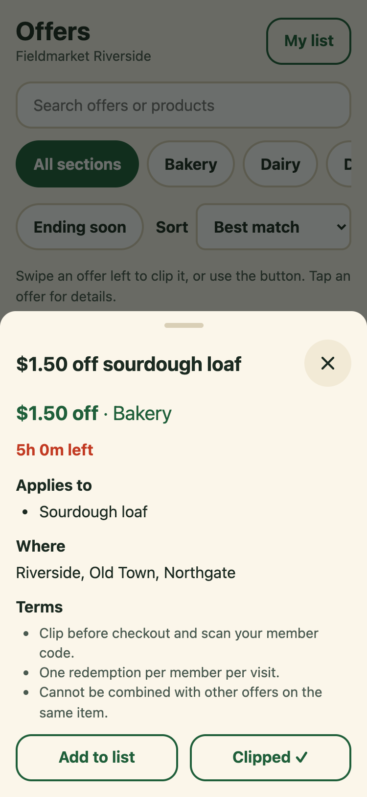</td>
    <td>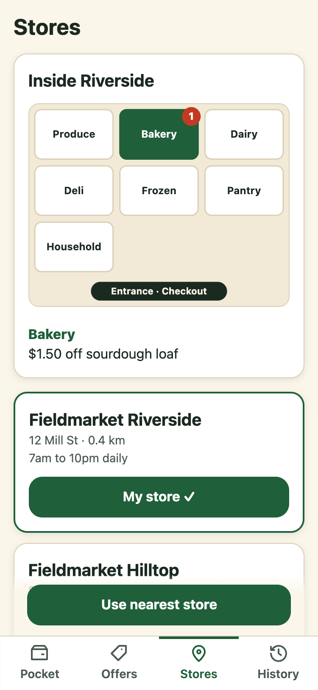</td>
  </tr>
  <tr>
    <td>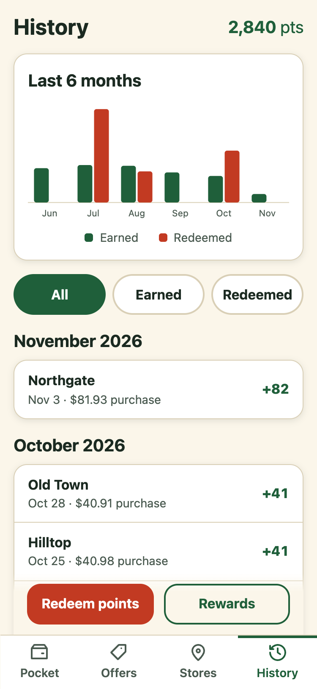</td>
    <td>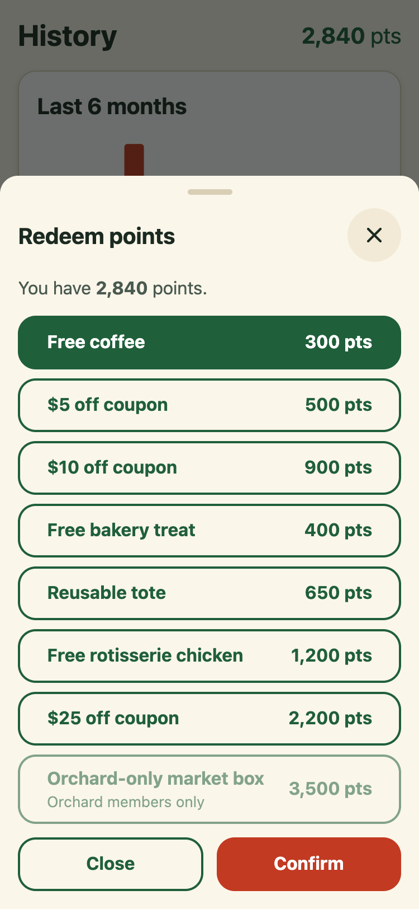</td>
    <td>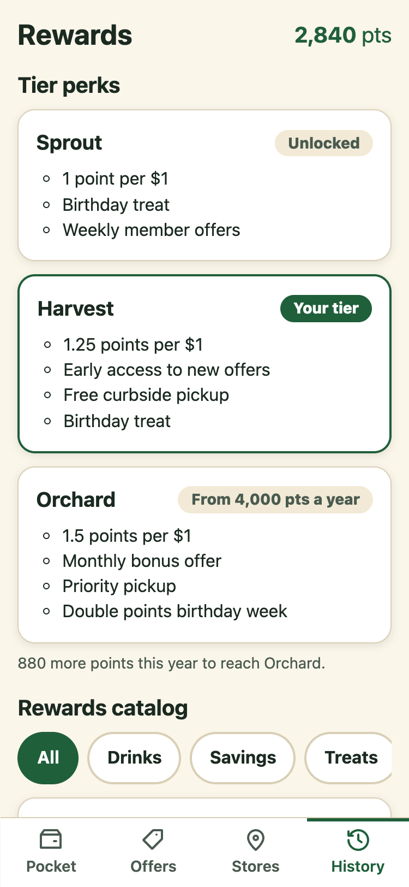</td>
    <td>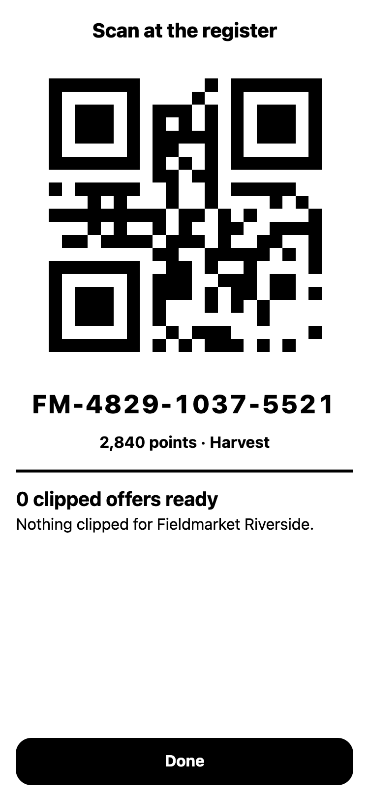</td>
  </tr>
  <tr>
    <td>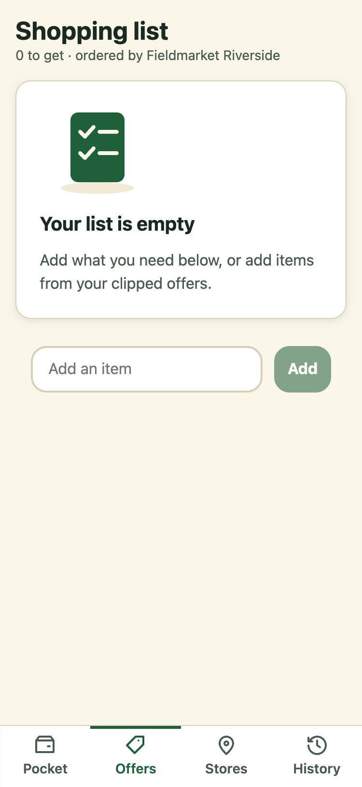</td>
    <td>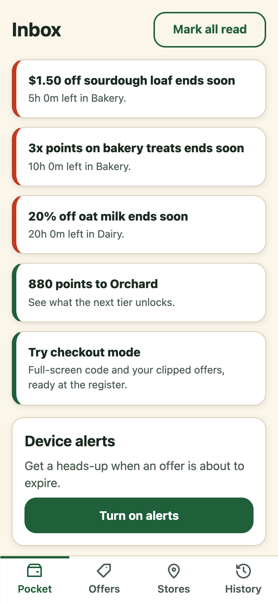</td>
    <td>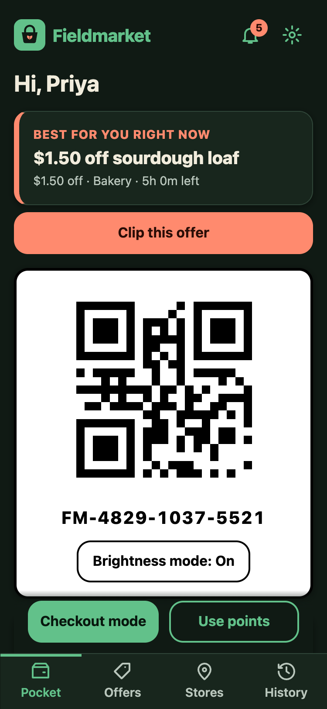</td>
    <td>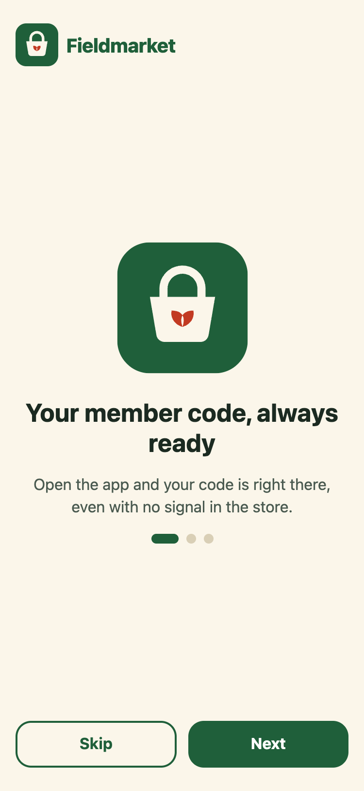</td>
  </tr>
</table>

## Design for the store, not the desk

- **One-handed and glanceable.** Primary actions sit in the bottom 40% of the screen, 48px touch targets, bottom tab bar, no hamburger menu.
- **Gestures have a button.** Swipe to clip always has a visible Clip button.
- **Signal is unreliable.** The member code is cached; clips queue offline and sync later; a banner says what is happening.
- **Accessible.** AA contrast in light and dark (tested), keyboard-operable sheets with focus trapping and return, text that scales to 200%, `prefers-reduced-motion` honoured, charts and the map have text alternatives.

## Tech

Vue 3, Vite, Vue Router, Pinia, VueUse (`useOnline`, `useStorage`, `useWakeLock`), `qrcode`, `vite-plugin-pwa`. Tests: Vitest, plus Playwright driving real Chrome with axe-core.

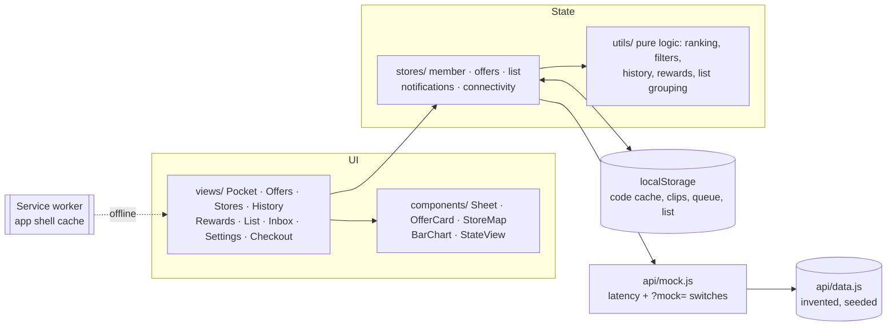

## Run locally

```bash
npm install
npm run dev        # http://localhost:5173
npm run build      # production build
```

### Demo switches

See every state without touching code. Add to any URL:

| Switch | Effect |
|--------|--------|
| `?mock=error` | Every API call fails (error states with retry) |
| `?mock=empty` | Every API call returns nothing (empty states) |
| `?mock=error-offers`, `?mock=empty-history`, … | Target one area: `member`, `offers`, `stores`, `history`, `redeem` |

For offline: DevTools → Network → Offline. The code stays, clips queue, and they sync when you reconnect.

## Quality checks

```bash
npm test           # 52 unit tests: ranking, filters, expiry, history, rewards, queue/sync, data vs. brief, AA contrast for both themes
npm run audit      # real Chrome across every route at 320/375/768px, light and dark: console errors, overflow, 44px targets, axe WCAG 2.1 AA
npm run e2e        # 21 end-to-end flows in real Chrome: intro, clip, search, sheets and focus, list, redeem, offline queue, errors, themes, reduced motion
npm run check      # all of the above
```

`npm run demo` re-records `docs/demo.gif`; `npm run icons` re-renders the PWA icons from the logo. These use your installed Chrome (set `CHROME_PATH` to override).

## Repo guide

- `BRIEF.md`: the plan (user, flows, design direction) plus an "as built" section
- `CLAUDE.md` and `docs/memory-bank/`: AI context, decisions, and progress
- `docs/user-flows.md`, `docs/design-tokens.md`: flows and tokens
- `src/`: `views/`, `components/`, `stores/`, `utils/`, `composables/`, `api/`
- `tests/`: unit tests · `scripts/`: browser audit, e2e, demo and icon generators

## License

MIT. See `LICENSE`.
